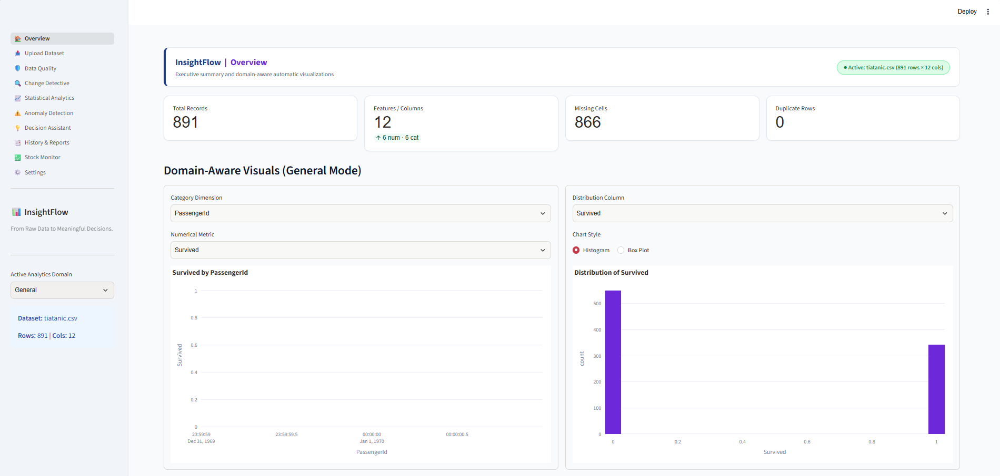
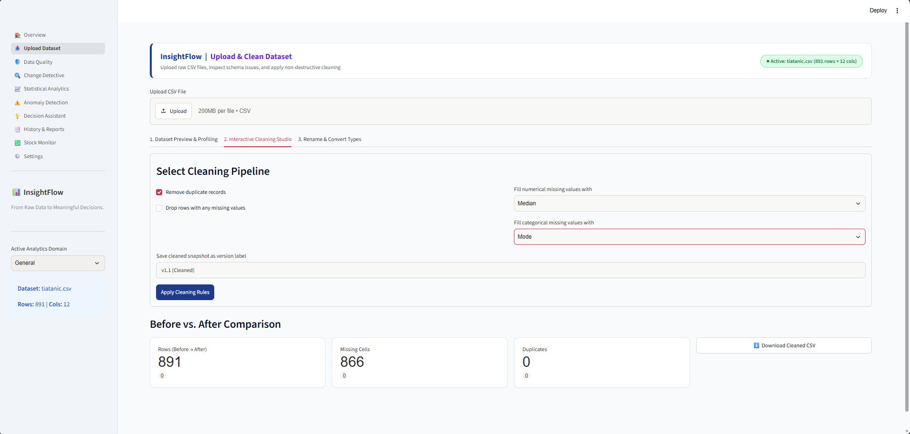
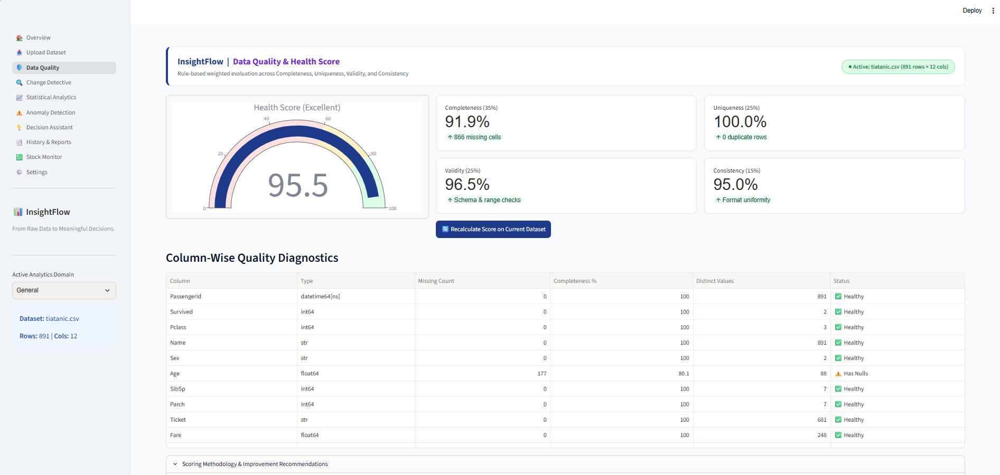
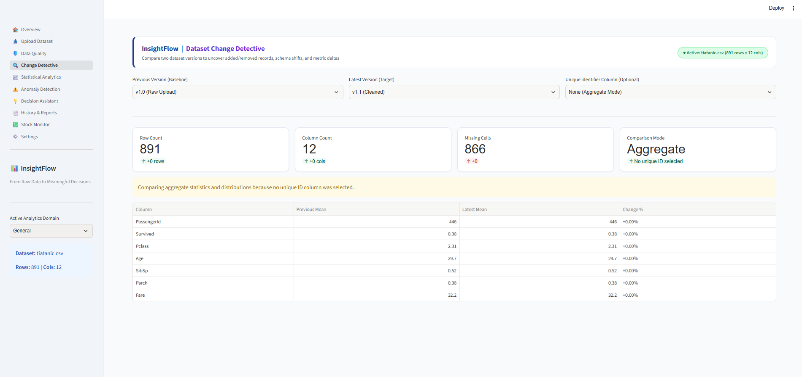
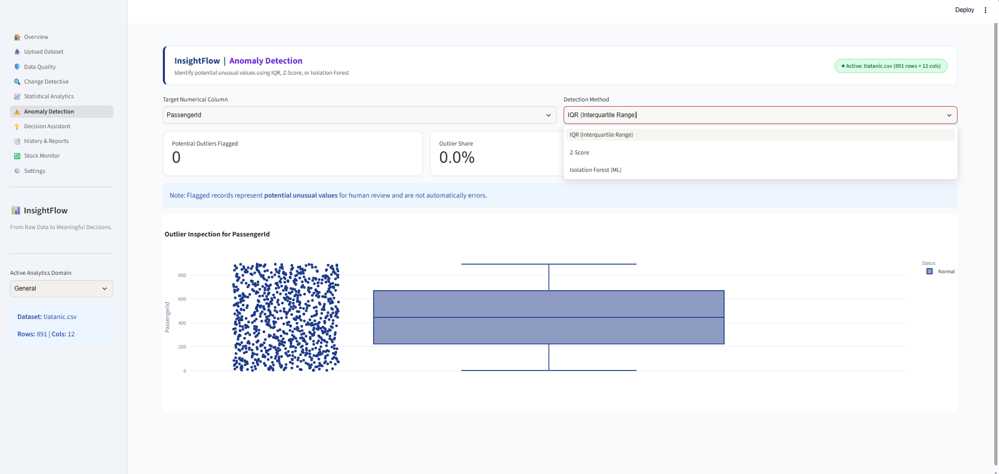
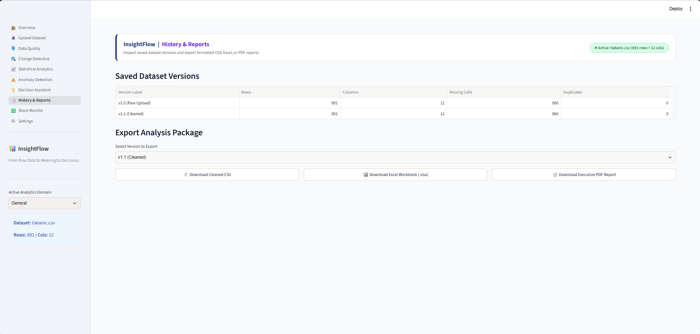
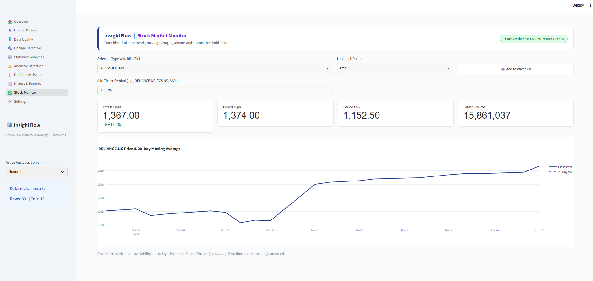

# 📊 InsightFlow – Intelligent Data Quality, Analysis & Change Monitoring Platform

> **From Raw Data to Meaningful Decisions.**

**InsightFlow** is an end-to-end, interactive data analytics and quality engineering web application built entirely in **Python** and **Streamlit**. It empowers analysts, students, and decision-makers to upload raw CSV datasets, automatically audit and clean data quality issues, detect version-over-version dataset changes, uncover statistical anomalies, generate rule-based business recommendations, and monitor stock market trends—all from a single unified dashboard.



*Figure 1: InsightFlow Executive Overview & Domain-Aware Interactive Dashboard*

---

## 🎯 Problem Statement & Motivation

In real-world analytics workflows, raw datasets frequently suffer from missing values, duplicate records, schema inconsistencies, and silent updates across versions. Traditional tools force users to jump between spreadsheets, custom Python scripts, and BI dashboards.

**InsightFlow** unifies data cleaning, health scoring, version comparison (**Change Detective**), statistical profiling, and automated PDF/Excel reporting into one self-contained platform.

---

## ✨ Key Features

### 1. 📤 Automated CSV Profiling & Non-Destructive Cleaning

- Upload any raw `.csv` file or explore instantly using the built-in **Demo Dataset**.
- Automatically detects row/column counts, numerical vs. categorical schemas, missing cells, and duplicate rows.
- Interactive cleaning pipeline:
  - Duplicate removal
  - Missing-value handling
  - Mean/Median numerical imputation
  - Mode categorical imputation
  - Column renaming
  - Data-type casting
- Preserves the original raw dataset without overwriting it.



*Figure 2: Interactive Data Cleaning Pipeline with Before-and-After Metrics*

---

### 2. 🛡️ Rule-Based Dataset Health Scoring Engine

Evaluates data quality across four weighted dimensions:

- **Completeness (35%)** – Ratio of non-null cells.
- **Uniqueness (25%)** – Absence of duplicate records.
- **Validity (25%)** – Schema and range compliance.
- **Consistency (15%)** – Format uniformity across columns.

Displays an interactive **0–100 Health Gauge**, column-wise quality diagnostics, and actionable remediation tips.



*Figure 3: Weighted Dataset Health Gauge & Column-Level Diagnostics*

---

### 3. 🔍 Dataset Change Detective (Version Comparison)

- Compares any two saved dataset snapshots (**Baseline vs. Target**).
- Supports **Record-Level Diffing**, identifying exact added and removed rows using a Unique ID column.
- Supports **Aggregate Statistical Comparison** when no unique key is present.
- Highlights structural row/column differences, missing-value improvements, and percentage shifts in numerical means.



*Figure 4: Side-by-Side Version Comparison & Added/Removed Record Detection*

---

### 4. 📈 Statistical Analytics & Domain-Aware Visualizations

- Computes:
  - Mean
  - Median
  - Mode
  - Standard Deviation
  - Variance
  - Minimum and Maximum
  - Quartiles (Q1/Q3)
- Generates interactive correlation heatmaps.
- Adapts visualization recommendations across:
  - General
  - Business
  - Finance
  - Education

Uses **Plotly** for interactive data visualization.

---

### 5. ⚠️ Multi-Method Anomaly Detection

Identifies potential outliers using multiple statistical and machine learning approaches:

- **IQR (Interquartile Range)**
- **Z-Score Thresholding**
- **Isolation Forest (Scikit-Learn Machine Learning)**

Helps identify unusual data patterns without automatically treating every extreme value as an error.



*Figure 5: Outlier Inspection & Severity Classification*

---

### 6. 💡 Rule-Based Data-to-Decision Assistant

Converts statistical and data-quality findings into a structured **3-Step Executive Brief**:

1. **Observation** – What the data shows.
2. **Possible Explanation** – Why it may be happening.
3. **Recommended Action** – The next concrete step to take.

Helps users transform raw analytical findings into meaningful and actionable insights.

---

### 7. 📑 Version History & Multi-Format Reporting

Export saved dataset snapshots into multiple formats:

- **Cleaned CSV** (`.csv`)
- **Multi-Sheet Excel Workbook** (`.xlsx` via OpenPyXL)
- **Styled Executive Summary Report** (`.pdf` via ReportLab)

Provides version history and downloadable reports for easier data management and documentation.



*Figure 6: Version Snapshot Manager & One-Click PDF/Excel/CSV Export*

---

### 8. 💹 Stock Market Monitor & Watchlist

Powered by `yfinance` to track Indian and global equities.

Supported example tickers:

- `RELIANCE.NS`
- `TCS.NS`
- `INFY.NS`
- `AAPL`

Features include:

- Historical closing prices.
- 20-Day Moving Averages.
- Trading volume visualization.
- Period highs and lows.
- Configurable percentage-move alerts.



*Figure 7: Interactive Stock Trend Chart & Threshold Alert System*

---

## 🛠️ Technology Stack

| Layer | Technologies Used |
|---|---|
| Frontend UI & Layout | Python, Streamlit |
| Data Processing & Mathematics | Pandas, NumPy |
| Machine Learning | Scikit-Learn (Isolation Forest) |
| Data Visualization | Plotly, Matplotlib, Seaborn |
| Financial Data | yfinance |
| Document Generation | ReportLab (PDF), OpenPyXL (Excel) |
| Version Control | Git, GitHub |

---

## 📂 Project Architecture

```text
InsightFlow/
├── app.py
├── config.py
├── requirements.txt
├── README.md
├── assets/
│   ├── dashboard_overview.png
│   ├── upload_cleaning_studio.png
│   ├── data_quality_score.png
│   ├── change_detective.png
│   ├── anomaly_detection.png
│   ├── history_reports.png
│   └── stock_monitor.png
├── core/
│   └── report_generator.py
├── ui/
│   ├── components.py
│   └── state.py
└── pages/
    ├── dashboard.py
    ├── upload_dataset.py
    ├── data_quality.py
    ├── change_detective.py
    ├── analytics.py
    ├── anomaly_detection.py
    ├── decision_assistant.py
    ├── history_reports.py
    ├── stock_monitor.py
    └── settings.py
```

---

## 🚀 How to Run Locally

### Prerequisites

- Python 3.10 or above
- Git
- A code editor such as VS Code

### Step 1: Clone the Repository

```bash
git clone https://github.com/goudaishwar046-oss/InsightFlow.git
cd InsightFlow
```

### Step 2: Create a Virtual Environment

**Windows:**

```powershell
python -m venv venv
venv\Scripts\activate
```

**macOS / Linux:**

```bash
python3 -m venv venv
source venv/bin/activate
```

### Step 3: Install Dependencies

```bash
pip install -r requirements.txt
```

### Step 4: Launch the Application

```bash
streamlit run app.py
```

### Step 5: Explore InsightFlow

Open the following address in your browser:

```text
http://localhost:8501
```

Click **⚡ Load Demo Dataset** in the sidebar to populate sample business data and explore the available modules.

---

## 👥 Contributors

- **Ishwar Rama Gouda** – Project development, frontend UI/UX, data cleaning pipeline and reporting.
- **ShantheshGM** – Project development, feature implementation and PowerPoint presentation creation.
- **Shivam Yadav** – Project development, data analysis, testing and documentation support.

---

## 🎯 Project Objective

The main objective of InsightFlow is to simplify data quality management and analytics by bringing multiple data processing, monitoring, and reporting capabilities into one interactive platform.

**From raw datasets to reliable insights and better decisions.**

---

## ⭐ Support

If you find this project interesting, consider giving the repository a ⭐ on GitHub!

**GitHub Repository:**  
https://github.com/goudaishwar046-oss/InsightFlow